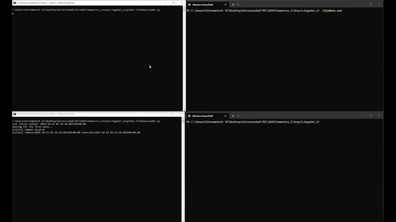

# Online Chess in x86 Assembly (Irvine32)

🇬🇧 English | [🇪🇸 Español](README.es.md)

A two-player chess game for the Windows console. All game logic and the user interface are written in **x86 assembly (MASM) with the Irvine32 library**. A small **Python script** syncs the game state between two computers through **Firebase Firestore**, so each player can play from their own machine.

> Built for the **Computer Architecture** course at the **Instituto Tecnológico de Costa Rica (TEC)**, 2nd semester of 2024.

**Authors**

- Mario Andrés Rojas Varela
- Sebastián Josué Sandí Blanco

**Demo:** _https://youtu.be/2ouz1pZpi7w_


---

## Table of contents

1. [What is this project?](#what-is-this-project)
2. [Features](#features)
3. [How it works](#how-it-works)
4. [Requirements](#requirements)
5. [Firebase setup](#firebase-setup)
6. [Building the executable](#building-the-executable)
7. [How to play](#how-to-play)
8. [Controls and implemented rules](#controls-and-implemented-rules)
9. [Troubleshooting](#troubleshooting)
10. [Known limitations](#known-limitations)
11. [Repository structure](#repository-structure)
12. [Security](#security)
13. [Credits](#credits)

---

## What is this project?

The goal of the course was to build a complete application programmed at a low level. This project implements a chess game playable over a network where:

- The **board, pieces, menus and move validation** live entirely in assembly, working directly with registers, memory, structures and Windows API calls.
- **Networking** is delegated to a Python bridge, because the assembly program can only read and write a local text file.

## Features

- Console interface with a splash screen and main menu (new game, history, settings, exit).
- Colored board drawn separately for each player (white sees the board from the bottom, black from their own side).
- Pieces drawn with **Unicode chess symbols** (♚ ♛ ♜ ♝ ♞ ♙). Each side is distinguished by color.
- Customizable board and piece colors, either manually or with predefined combinations.
- Player nicknames.
- Move validation per piece type: pawn, rook, knight, bishop, queen and king.
- Path checking (rook, bishop and queen cannot jump over pieces) and capturing of enemy pieces.
- Online play between two computers through Firestore.

## How it works

```
 Player 1 (PC A)                                          Player 2 (PC B)
┌─────────────────┐                                     ┌─────────────────┐
│  Ajedrez.exe    │                                     │  Ajedrez.exe    │
│  (assembly)     │                                     │  (assembly)     │
└───────┬─────────┘                                     └─────────┬───────┘
        │ reads / writes                                          │ reads / writes
   ┌────▼──────────┐                                       ┌──────▼────────┐
   │ GameFile.txt  │                                       │ GameFile.txt  │
   └────┬──────────┘                                       └──────┬────────┘
        │ syncs                                                   │ syncs
┌───────▼─────────┐        ┌───────────────────────┐      ┌───────▼─────────┐
│FileDownloader.py│◄──────►│  Firebase Firestore   │◄────►│FileDownloader.py│
└─────────────────┘        │ ajedrez/GameFile      │      └─────────────────┘
                           └───────────────────────┘
```

1. The executable saves the game state to `GameFile.txt` every time the player moves, then waits ("Waiting for opponent's response").
2. `FileDownloader.py` checks every 3 seconds whether the local file changed. If it did, it uploads it to Firestore (document `GameFile` in the `ajedrez` collection).
3. On the other computer, its own copy of `FileDownloader.py` detects that the remote document changed and rewrites the local `GameFile.txt`.
4. The other player's executable notices the file changed, loads the pieces, and it is their turn.

### `GameFile.txt` format

Plain text. In the base version of the project the format is:

```
<status><turn>*<piece><color><column><row>/<piece><color><column><row>/ ... %
```

| Part | Meaning |
|---|---|
| First character | Game status. A `5` means the game is over, and both Python scripts exit. |
| Second character | Whose turn it is. It is also used to assign colors: whoever finds a `2` at startup plays black. |
| `*` | Header separator. |
| Each piece (5 bytes) | Type (`K`, `Q`, `R`, `B`, `N`, `P`), color (`w`/`b`), column (`A`-`H`), row (`1`-`8`) and the `/` separator. |
| `%` | End of file. |

> If you change the format in the assembly code, the Python script needs no changes: it just moves bytes without interpreting them.

### Who plays white

Roles are not assigned in advance. **Whoever creates the game first plays white.** When creating the game, the executable writes `02%` to `GameFile.txt`. That file reaches the other player through Firebase, and when the second executable finds it, it assigns itself black.

This is why the **startup order matters** (see [How to play](#how-to-play)).

## Requirements

### To play (each player)

| Requirement | Details |
|---|---|
| Operating system | Windows 10 or 11 |
| Terminal | **Windows Terminal** (recommended). The classic CMD has no fonts with the chess symbols and shows them as boxes with a question mark. |
| Python | Python 3.8 or later |
| Python library | `firebase-admin` (`pip install firebase-admin`) |
| Firebase | A project with Firestore and a service account key (see below) |
| Files | The `.exe`, `GameFile.txt`, `FileDownloader.py` and `serviceAccountKey.json`, **all in the same folder** |

Both players must use **the same Firebase project**. You can test everything on a single computer by using two folders (`Player_1/` and `Player_2/`), each with its own copy of the four files.

### To build (only if you will modify the code)

- Visual Studio 2022 (Community is enough) with the **Desktop development with C++** workload, or the Visual Studio Build Tools.
- Kip Irvine's **Irvine32** library, downloadable from [asmirvine.com](https://asmirvine.com), extracted to `C:\Irvine`.

## Firebase setup

Done once; both players use the same project.

1. Go to the [Firebase console](https://console.firebase.google.com) and create a project.
2. Under **Build → Firestore Database** click **Create database**. Any region works. Firestore has a free tier that is enough for this project.
3. Under **Project settings → Service accounts** click **Generate new private key**. A `.json` file is downloaded.
4. Rename that file to **`serviceAccountKey.json`** and copy it into each player's folder.
5. **Never commit that file to a repository.** It is listed in `.gitignore`. A fake template is provided as `serviceAccountKey.example.json`.

By default the script uses the `ajedrez` collection and the `GameFile` document. They can be changed in the configuration section at the top of `FileDownloader.py`.

### Important sync detail

Firestore **does not update a document's modification time if you write exactly the same content**. Since the first file of every game (`02%`) is always identical to the previous game's, the script adds an `uploaded_at` field with `firestore.SERVER_TIMESTAMP` on every upload:

```python
result = doc_ref.set({'content': content, 'uploaded_at': firestore.SERVER_TIMESTAMP})
```

Without that field, the second player would never detect the change and both would wait forever.

## Building the executable

If you only want to play, use the prebuilt `.exe` from the *Releases* section and skip this step.

### Option A: Visual Studio

1. Create an **Empty Project (C++)** and add the `.asm` file with *Add → Existing Item*.
2. Right-click the project → **Build Customizations...** → check **masm**.
3. Right-click the project → **Properties**, with *Configuration: All Configurations* and *Platform: **Win32*** (32-bit, never x64):

| Where | Value |
|---|---|
| Microsoft Macro Assembler → General → Include Paths | `C:\Irvine` |
| Linker → General → Additional Library Directories | `C:\Irvine` |
| Linker → Input → Additional Dependencies | `irvine32.lib;kernel32.lib;user32.lib` |
| Linker → System → SubSystem | `Console` |
| Linker → Advanced → Image Has Safe Exception Handlers | `No (/SAFESEH:NO)` |

4. Build with **Ctrl+Shift+B**. The `.exe` ends up in the solution's `Debug` folder.

> If you get error **LNK1168** ("cannot open for writing"), the previous executable is still running. Close it and rebuild.

### Option B: command line

From the *x86 Native Tools Command Prompt for VS*:

```bat
ml /c /coff /Zi /I C:\Irvine main.asm
link /SUBSYSTEM:CONSOLE /SAFESEH:NO /LIBPATH:C:\Irvine main.obj irvine32.lib kernel32.lib user32.lib
```

### A note on the piece symbols

Irvine32 prints using the Windows ANSI API and has no Unicode support. For that reason the pieces are drawn with `WriteConsoleW` (from `kernel32`), which takes UTF-16. The `printGlyph` procedure receives the piece letter in `AL` and translates it into its symbol; the rest of the game (and `GameFile.txt`) keeps using letters.

Good to know:

- The symbols are wider than one console cell. So that the background color covers the whole piece, `printGlyph` prints the symbol followed by a space.
- The filled pawn (♟) renders as an emoji and ignores text color. The outlined pawn (♙, U+2659) is used instead, since it respects color.

## How to play

Order matters. Follow these steps exactly.

### Preparation (each player)

1. Create a folder with: the `.exe`, `GameFile.txt`, `FileDownloader.py` and `serviceAccountKey.json`.
2. Install the dependency: `pip install firebase-admin`
3. Leave `GameFile.txt` **empty**.

### Starting a game

1. **Both players** open a terminal (Windows Terminal) in their folder and run:
   ```
   python FileDownloader.py
   ```
   Wait until both show they are waiting for the first move. **Both scripts must be running before the game is created.**
2. **Player 1 (white):** run the `.exe`, choose **1. New Game** and type a nickname. They are now waiting for the opponent.
3. **Player 2 (black):** before opening the `.exe`, check that the game has arrived:
   ```
   type GameFile.txt
   ```
   Repeat the command until it shows `02%`. **Only then** run the `.exe`, choose **New Game** and type a nickname.
4. The game starts and Player 1 moves first.

> If Player 2 opens the `.exe` before `02%` arrives, they also get assigned white and both players wait forever. If that happens, restart everything.

### Between games

- Close both `.exe` files and both scripts (Ctrl+C).
- Leave `GameFile.txt` empty in both folders and repeat from step 1.
- Exiting with option **4. Exit** writes the end-of-game marker (`5`) and the scripts close on their own.

## Controls and implemented rules

- To move, type the source square and then the destination square in algebraic notation, e.g. `E2` and then `E4`. The program accepts uppercase letters `A` to `H` and numbers `1` to `8`.
- If the source square is empty or the move is invalid, a red message is shown and the move is requested again.
- If the destination holds one of your own pieces, the move is rejected. If it holds an enemy piece, it is captured.
- In the menu, type the number of an option and press **Enter**.
- Under **3. Settings** you can change the board and piece colors.

## Troubleshooting

| Symptom | Cause and fix |
|---|---|
| Pieces show as boxes with `?` | You are using the classic CMD. Run the `.exe` from **Windows Terminal**. If it persists, change the font under *Settings → Defaults → Appearance* to Consolas or DejaVu Sans Mono. |
| Both windows stay on "Waiting for opponent's response" | Player 2 opened the `.exe` before `02%` arrived, or the Python scripts were not running before the game was created. Close everything and repeat the order in [How to play](#how-to-play). |
| A Python script prints `Sync error (will retry)` | Check that `serviceAccountKey.json` is in the folder, that both players use a key from the same project, and that Firestore has been created. |
| `No module named 'firebase_admin'` | Run `python -m pip install firebase-admin` (use the same Python you run the script with). |
| The script exits on its own | The local file started with `5` (game over). Empty `GameFile.txt` and start again. |
| LNK1168 when building | The previous `.exe` is still open. Close it and rebuild. |
| The splash screen or board looks garbled | The window is too small. Widen it (the game needs about 120 columns). |
| After rebuilding, letters still appear instead of symbols | You are running an old copy of the `.exe`. Building does not update the copies in the players' folders: copy it over again by hand. |

## Known limitations

- **It does not detect check or checkmate.** The game does not warn when a king is in check and does not end the game automatically; players must agree on the result and exit through the menu.
- There is no draw or end-of-game detection.
- Syncing is by polling every 3 seconds, so there is a small delay between moves.
- Tested only on Windows with Windows Terminal.
- The script uses a single shared game (one Firestore document), so only one game at a time can run per Firebase project.

## Repository structure

```
.
├── README.md
├── README.es.md
├── src/
│   └── main.asm                       # Game logic and UI (MASM + Irvine32)
├── FileDownloader.py                  # Firestore sync bridge
├── GameFile.txt                       # Communication channel (kept empty)
├── serviceAccountKey.example.json     # Template with fake values
└── .gitignore                         # Excludes the real key
```

_(Adjust the names to match how you organize the repository.)_

## Security

- `serviceAccountKey.json` gives administrative access to your Firebase project. **Do not commit it.** Add this to `.gitignore`:
  ```
  serviceAccountKey.json
  *firebase-adminsdk*.json
  ```
- If a key was ever published or shared, revoke it under *Project settings → Service accounts → Manage service account permissions in Google Cloud* and generate a new one. If it reached a commit, clean the history (for example with `git filter-repo`) or recreate the repository from scratch.

## Credits

Project 1 of the **Computer Architecture** course, Instituto Tecnológico de Costa Rica, 2nd semester 2024.

- Mario Andrés Rojas Varela
- Sebastián Josué Sandí Blanco

Irvine32 library: Kip Irvine, *Assembly Language for x86 Processors*.
